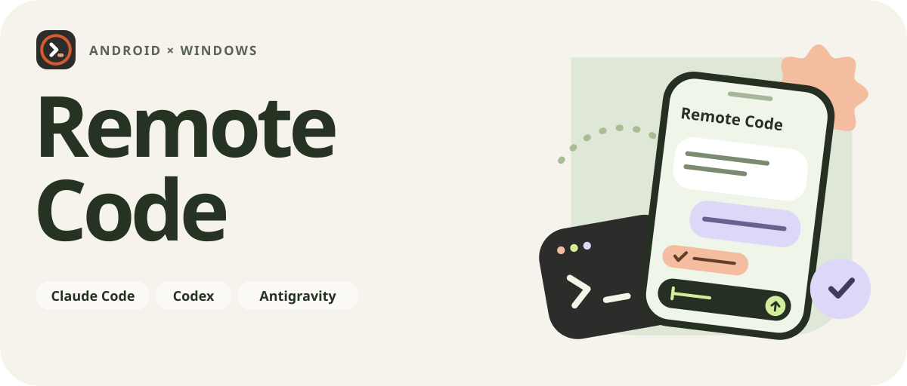
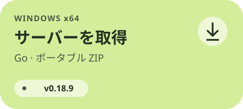
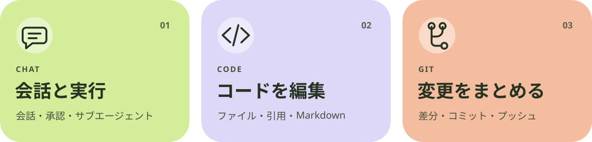
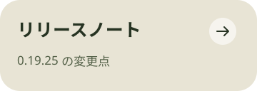

<p align="center">
  
</p>

<p align="center">Android から、PC の Claude Code・Codex・Antigravity を操作。</p>
<p align="center">
  
</p>
<p align="center">
  <a href="README.md"></a>
  <a href="README.ja.md"></a>
  <a href="README.zh-CN.md"></a>
  <a href="README.zh-Hant.md"></a>
  <a href="README.ko.md"></a>
</p>

<a name="ダウンロード"></a>

<h2></h2>

<p align="center">
  <a href="https://github.com/lighfu/remote-code/releases/download/v0.19.12/remote-code-v0.19.12-win32-x64.zip"></a>
</p>

Windows 用の配布パッケージは [GitHub Releases](https://github.com/lighfu/remote-code/releases) から取得できます。

Android アプリは、PC で `start.cmd` を開き、ターミナルの **App QR** をスマートフォンで読み取ってインストールします。[導入手順](#導入)

<a name="機能"></a>

<h2></h2>

<p align="center">
  
</p>

- **会話** — 送信・再開、ツールの承認、サブエージェントの確認、バックグラウンド通知。
- **ファイル** — 画像・動画・ファイルの添付と表示、コード編集・引用、Markdown プレビュー。
- **Git・使用量** — 差分・履歴・ブランチ、ステージ操作、コミット・プッシュ。利用状況・コンテキスト・キャッシュの表示。
- **リモートデスクトップ** — ホーム画面のモニターアイコンをタップすると、PCの全ディスプレイをまとめて表示するか、1つを選んで表示できます。標準のタッチパッドモードでは、1本指のスライドでポインターを動かし、1本指のタップで左クリック、2本指のタップで右クリックできます。ピンチ操作で最大32倍まで拡大でき、キーボードを開いて文字入力もできます。

<a name="導入"></a>

<h2></h2>

Windows x64 および Android 10+ に対応しています。サーバーダッシュボードの **5 Setup** を使って使用するネイティブ CLI をインストールし、そこに表示される実行コマンドを使って PC でサインインしてください。

接続した Android アプリのサーバー設定からインストールをリクエストすることもできます。

Windows 用 ZIP には、Go 製ネイティブサーバー、`start.cmd`、Android APK を同梱しています。設定と会話は `data/` に保存されます。

1. Windows ZIP を新しいフォルダーに展開します。
2. `start.cmd` を開き、**5 Setup** を開いて使用する CLI と Quick Tunnel 用の `cloudflared` をインストールします。
3. PC でインストールした CLI にサインインします。
4. **App QR** またはダウンロード URL から APK をインストールします。
5. アプリで接続 QR コードを読み取ります。

利用中はターミナルを開いたままにしてください。

セットアップでは利用可能な場合は WinGet を優先し、そうでない場合はプロバイダーの公式リリース元から Windows ネイティブ実行ファイルをダウンロードします。Cloudflare Tunnel 接続では、`cloudflared` のインストール後にポータブルランチャーがトンネルを自動的に開始します。ソースから実行する場合は `--tunnel` で有効化します。

コンソールはクリック、矢印キーと Enter で操作できます。`R` で再起動、`Q` で終了します。通常のログ表示は `--no-ui` を指定します。

サーバー更新は起動時に確認し、承認後に適用します。アプリ内の更新には、接続中のサーバーが配信する APK を使います。

<a name="開発"></a>

<h2></h2>

### 開発環境とコマンド

サーバーは Go で実装しています。ソースからの実行とビルドには Go 1.26 以降が必要です。

Claude Code は PC にインストール済みの実行ファイルを使います。配布 ZIP に Claude Code 本体は含みません。

```powershell
go run ./cmd/remote-code --tunnel
```

Windows 用サーバーの実行ファイルは、リポジトリのルートで次のコマンドを実行して作成できます。

```powershell
go build -o remote-code.exe ./cmd/remote-code
.\remote-code.exe --tunnel
```

Android アプリのビルドには JDK 21 と Android SDK Platform 37.2 が必要です。

```powershell
.\android\gradlew.bat -p android assembleRelease
```

APK は `android/app/build/outputs/apk/release/app-release.apk` に生成されます。設定は `data/config.json`、起動オプションは `go run ./cmd/remote-code --help` で確認できます。

<a name="ドキュメント"></a>

<h2></h2>

<p>
  <a href="docs/releases/ja/0.19.12.md"></a>
</p>
