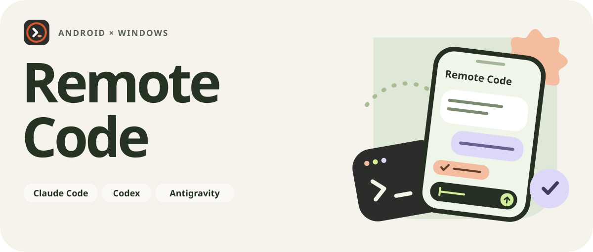
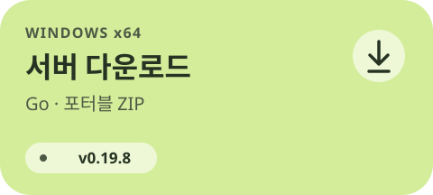

<p align="center">
  
</p>

<p align="center">Android에서 PC의 Claude Code, Codex, Antigravity를 제어하세요.</p>
<p align="center">
  
</p>
<p align="center">
  <a href="README.md"></a>
  <a href="README.ja.md"></a>
  <a href="README.zh-CN.md"></a>
  <a href="README.zh-Hant.md"></a>
  <a href="README.ko.md"></a>
</p>

<a name="다운로드"></a>

<h2></h2>

<p align="center">
  <a href="https://github.com/lighfu/remote-code/releases/download/v0.18.8/remote-code-v0.18.8-win32-x64.zip"></a>
</p>

Windows용 배포판은 [GitHub Releases](https://github.com/lighfu/remote-code/releases)에서 다운로드할 수 있습니다.

Android 앱을 설치하려면 PC에서 `start.cmd`를 실행한 뒤, 휴대전화로 터미널의 **App QR** 코드를 스캔하세요. [설치 안내](#설치)

<a name="기능"></a>

<h2></h2>

<p align="center">
  
</p>

- **대화** — 대화 전송 및 재개, 도구 실행 승인, 서브에이전트 확인, 백그라운드 알림.
- **파일** — 이미지·동영상·파일 첨부 및 보기, 코드 편집·인용, Markdown 미리보기.
- **Git·사용량** — 변경 내역(diff)·기록·브랜치 확인, 스테이징, 커밋·푸시. 사용량·컨텍스트·캐시 표시.

<a name="설치"></a>

<h2></h2>

Windows x64 및 Android 10+를 지원합니다. 서버 대시보드의 **5 Setup**을 사용하여 사용할 네이티브 CLI를 설치한 다음, 거기에 표시된 실행 명령을 사용하여 PC에서 로그인하세요.

연결된 Android 앱의 서버 설정에서 설치를 요청할 수도 있습니다.

Windows ZIP에는 Go 네이티브 서버, `start.cmd`, Android APK가 포함되어 있습니다. 설정과 대화는 `data/`에 저장됩니다.

1. 새 폴더에 Windows ZIP의 압축을 풉니다.
2. `start.cmd`를 연 다음 **5 Setup**을 열어 선택한 CLI와 Quick Tunnel용 `cloudflared`를 설치합니다.
3. PC에 설치된 CLI에 로그인합니다.
4. **App QR** 또는 다운로드 URL을 사용하여 APK를 설치합니다.
5. 앱에서 연결 QR 코드를 스캔합니다.

사용 중에는 터미널 창을 닫지 말고 열어 두세요.

설치 시 사용 가능한 경우 WinGet을 우선하며, 그렇지 않은 경우 제공업체의 공식 릴리스 소스에서 네이티브 Windows 실행 파일을 다운로드합니다. Cloudflare Tunnel 연결의 경우 `cloudflared`가 설치된 후 포터블 런처가 터널을 자동으로 시작합니다. 소스 실행 시에는 `--tunnel`로 활성화합니다.

서버는 시작할 때 업데이트를 확인하고 승인 후 적용합니다. Android 앱은 연결된 서버에서 업데이트용 APK를 받습니다.

<a name="개발"></a>

<h2></h2>

### 개발 환경 및 명령어

서버는 Go로 작성되었습니다. 소스에서 실행하고 빌드하려면 Go 1.26 이상이 필요합니다.

Claude Code는 PC에 이미 설치된 실행 파일을 사용합니다. 배포용 ZIP에는 Claude Code 본체가 포함되어 있지 않습니다.

```powershell
go run ./cmd/remote-code --tunnel
```

저장소 루트에서 다음 명령을 실행하면 Windows 서버 실행 파일을 빌드하고 실행할 수 있습니다.

```powershell
go build -o remote-code.exe ./cmd/remote-code
.\remote-code.exe --tunnel
```

Android 앱 빌드에는 JDK 21과 Android SDK Platform 37.2가 필요합니다.

```powershell
.\android\gradlew.bat -p android assembleRelease
```

APK는 `android/app/build/outputs/apk/release/app-release.apk`에 생성됩니다. 설정은 `data/config.json`에서, 시작 옵션은 `go run ./cmd/remote-code --help`에서 확인할 수 있습니다.

<a name="문서"></a>

<h2></h2>

<p>
  <a href="docs/releases/ko/0.18.8.md"></a>
</p>
