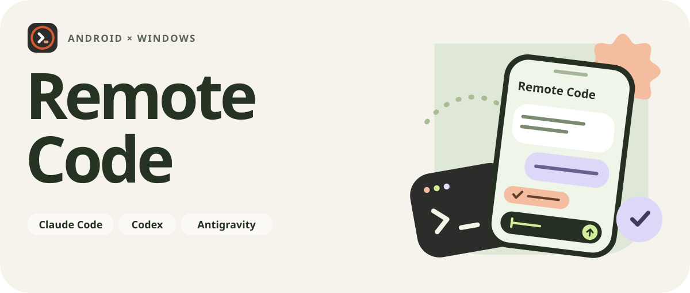
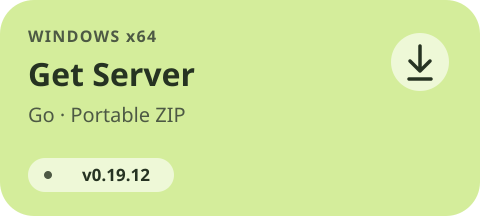
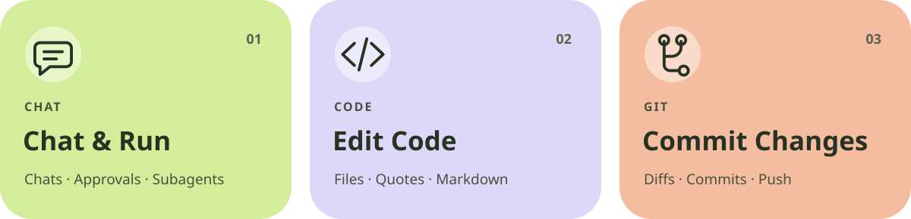
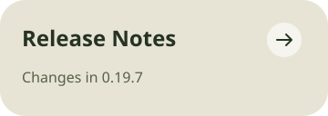

<p align="center">
  
</p>

<p align="center">Control Claude Code, Codex, and Antigravity on your PC from Android.</p>
<p align="center">
  
</p>
<p align="center">
  <a href="README.md"></a>
  <a href="README.ja.md"></a>
  <a href="README.zh-CN.md"></a>
  <a href="README.zh-Hant.md"></a>
  <a href="README.ko.md"></a>
</p>

<a name="download"></a>

<h2></h2>

<p align="center">
  <a href="https://github.com/lighfu/remote-code/releases/download/v0.19.4/remote-code-v0.19.4-win32-x64.zip"></a>
</p>

Windows packages are available on [GitHub Releases](https://github.com/lighfu/remote-code/releases).

To install the Android app, open `start.cmd` on your PC and scan the terminal’s **App QR** code with your phone. [Setup guide](#setup)

<a name="features"></a>

<h2></h2>

<p align="center">
  
</p>

- **Chat** — Send and resume chats, approve tool calls, inspect subagents, and receive background notifications.
- **Files** — Attach and view images, videos, and files, edit and quote code, and preview Markdown.
- **Git & Usage** — View diffs, history, and branches, stage changes, commit, and push. Check usage, context, and cache status.
- **Remote desktop** — Tap the monitor icon on the home screen to view all PC displays together or choose one. In the default touchpad mode, slide one finger to move the pointer, tap to left-click, and tap with two fingers to right-click. Pinch to zoom up to 32× or open the keyboard to type.

<a name="setup"></a>

<h2></h2>

Supports Windows x64 and Android 10+. Use **5 Setup** in the server dashboard to install the native CLIs you use, then sign in on your PC using the executable command shown there.

You can also request installation from the connected Android app's server settings.

The Windows ZIP includes the native Go server, `start.cmd`, and the Android APK. Settings and conversations are stored in `data/`.

1. Extract the Windows ZIP into a new folder.
2. Open `start.cmd`, then open **5 Setup** to install your chosen CLI and `cloudflared` for Quick Tunnel.
3. Sign in to the installed CLI on your PC.
4. Install the APK using **App QR** or its download URL.
5. Scan the connection QR code in the app.

Keep the terminal open while using the tool.

Setup prefers WinGet when available and otherwise downloads the native Windows executable from the provider's official release source. For Cloudflare Tunnel connections, the portable launcher starts the tunnel automatically after `cloudflared` is installed. Source runs enable it with `--tunnel`.

The server checks for updates at startup and applies them after your approval. The app downloads its updates from the server it’s connected to.

<a name="development"></a>

<h2></h2>

### Environment & Commands

The server is written in Go. Building and running from source requires Go 1.26 or later.

Claude Code uses the executable already installed on your PC. The distributed ZIP does not include Claude Code itself.

```powershell
go run ./cmd/remote-code --tunnel
```

To build a Windows server executable, run the following in the repository root.

```powershell
go build -o remote-code.exe ./cmd/remote-code
.\remote-code.exe --tunnel
```

Building the Android app requires JDK 21 and Android SDK Platform 37.2.

```powershell
.\android\gradlew.bat -p android assembleRelease
```

The APK is generated at `android/app/build/outputs/apk/release/app-release.apk`. Configuration is stored in `data/config.json`, and startup options can be checked with `go run ./cmd/remote-code --help`.

<a name="docs"></a>

<h2></h2>

<p>
  <a href="docs/releases/0.19.4.md"></a>
</p>
