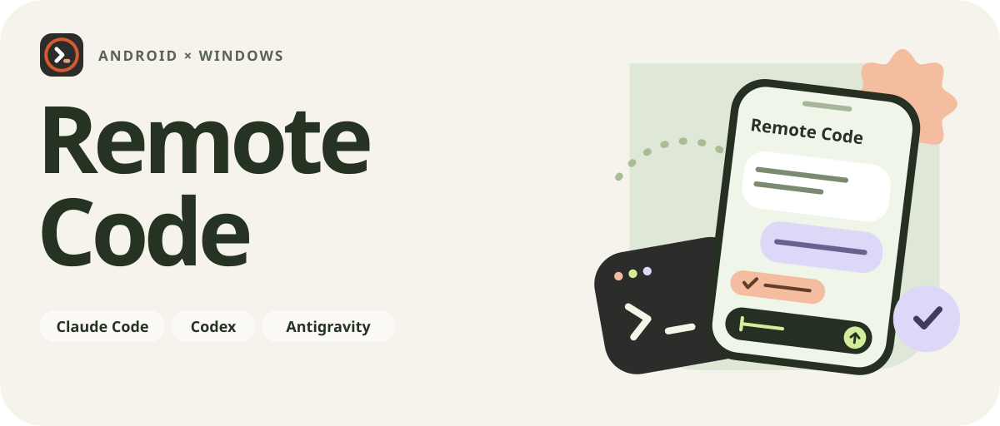
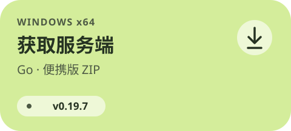
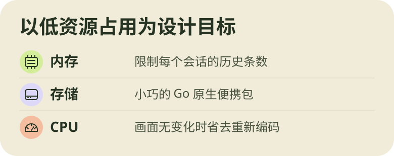

<p align="center">
  
</p>

<p align="center">从 Android 操控 PC 上的 Claude Code、Codex 与 Antigravity。</p>
<p align="center">
  
</p>
<p align="center">
  <a href="README.md"></a>
  <a href="README.ja.md"></a>
  <a href="README.zh-CN.md"></a>
  <a href="README.zh-Hant.md"></a>
  <a href="README.ko.md"></a>
</p>

<a name="下载"></a>

<h2></h2>

<p align="center">
  <a href="https://github.com/lighfu/remote-code/releases/download/v0.19.25/remote-code-v0.19.25-win32-x64.zip"></a>
</p>

Windows 发行版可从 [GitHub Releases](https://github.com/lighfu/remote-code/releases) 下载。

要安装 Android 应用，请在电脑上运行 `start.cmd`，然后用手机扫描终端中的 **App QR** 二维码。[安装指南](#安装)

<a name="功能"></a>

<h2></h2>

<p align="center">
  
</p>

<p align="center">
  
</p>

- **对话** — 发送与恢复对话、审批工具调用、查看子智能体、接收后台通知。
- **文件** — 附加与查看图片、视频及文件，编辑与引用代码，预览 Markdown。
- **Git 与用量** — 查看差异、历史与分支，暂存变更、提交与推送。显示使用情况、上下文与缓存。
- **远程桌面** — 点按主屏幕上的显示器图标，即可同时查看所有电脑显示器或选择其中一个。在默认的触控板模式下，单指滑动可移动指针，单指轻点可左键单击，双指轻点可右键单击。双指缩放最高可放大至 32 倍，也可打开键盘输入文字。

<a name="安装"></a>

<h2></h2>

支持 Windows x64 和 Android 10+。使用服务器仪表板中的 **5 Setup** 安装所需的原生 CLI，然后使用其中显示的可执行命令在 PC 上登录。

您也可以从已连接的 Android 应用的服务器设置中请求安装。

Windows ZIP 内包含 Go 原生服务端、`start.cmd` 和 Android APK。配置与会话保存在 `data/` 中。

1. 将 Windows ZIP 解压到一个新文件夹中。
2. 打开 `start.cmd`，然后打开 **5 Setup** 安装所选的 CLI 以及用于 Quick Tunnel 的 `cloudflared`。
3. 在 PC 上登录已安装的 CLI。
4. 使用 **App QR** 或其下载链接安装 APK。
5. 在应用中扫描连接二维码。

使用期间请保持终端窗口处于打开状态。

安装过程在可用时优先使用 WinGet，否则会从提供商的官方发布源下载原生 Windows 可执行文件。对于 Cloudflare Tunnel 连接，安装 `cloudflared` 后便携式启动器会自动启动隧道。从源码运行时可通过 `--tunnel` 启用。

服务端会在启动时检查更新，并在确认后应用。Android 应用从当前连接的服务端获取更新用的 APK。

<a name="开发"></a>

<h2></h2>

### 开发环境与命令

服务端使用 Go 编写。从源码运行和构建需要 Go 1.26 或更高版本。

Claude Code 使用 PC 上已安装的可执行文件。发行版 ZIP 中不包含 Claude Code 本身。

```powershell
go run ./cmd/remote-code --tunnel
```

在仓库根目录执行以下命令，可构建并运行 Windows 服务端可执行文件。

```powershell
go build -o remote-code.exe ./cmd/remote-code
.\remote-code.exe --tunnel
```

构建 Android 应用需要 JDK 21 和 Android SDK Platform 37.2。

```powershell
.\android\gradlew.bat -p android assembleRelease
```

APK 生成路径为 `android/app/build/outputs/apk/release/app-release.apk`。配置文件位于 `data/config.json`，启动选项可通过 `go run ./cmd/remote-code --help` 查看。

<a name="文档"></a>

<h2></h2>

<p>
  <a href="docs/releases/zh-CN/0.19.25.md"></a>
</p>
