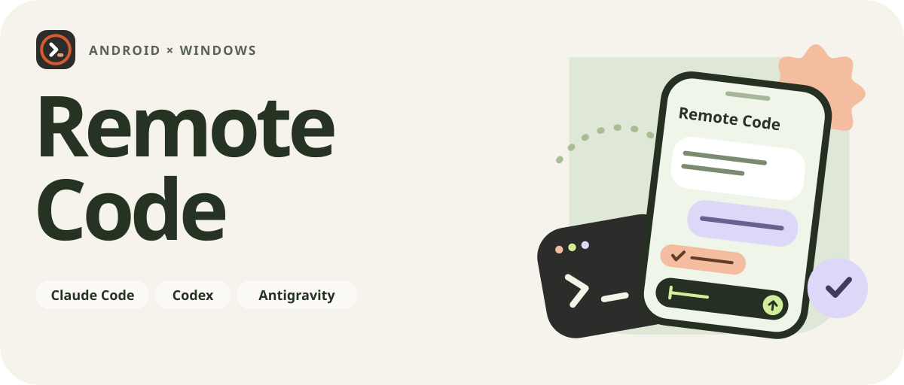
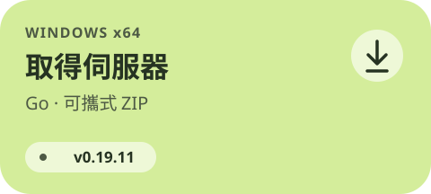
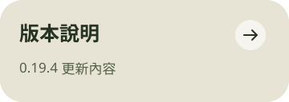

<p align="center">
  
</p>

<p align="center">透過 Android 操控電腦上的 Claude Code、Codex 與 Antigravity。</p>
<p align="center">
  
</p>
<p align="center">
  <a href="README.md"></a>
  <a href="README.ja.md"></a>
  <a href="README.zh-CN.md"></a>
  <a href="README.zh-Hant.md"></a>
  <a href="README.ko.md"></a>
</p>

<a name="下載"></a>

<h2></h2>

<p align="center">
  <a href="https://github.com/lighfu/remote-code/releases/download/v0.19.5/remote-code-v0.19.5-win32-x64.zip"></a>
</p>

Windows 套件可於 [GitHub Releases](https://github.com/lighfu/remote-code/releases) 下載。

若要安裝 Android 應用程式，請在電腦上開啟 `start.cmd`，再用手機掃描終端機中的 **App QR** 碼。[安裝指南](#安裝)

<a name="功能"></a>

<h2></h2>

<p align="center">
  
</p>

- **對話** — 傳送與繼續對話、核准工具呼叫、檢視子代理，並接收背景通知。
- **檔案** — 附加與檢視圖片、影片及檔案，編輯與引用程式碼，並預覽 Markdown。
- **Git 與用量** — 檢視差異、歷史記錄與分支，暫存變更、提交與推送。檢查用量、上下文與快取狀態。
- **遠端桌面** — 點按主畫面上的顯示器圖示，即可同時檢視所有電腦顯示器或選擇其中一個。在預設的觸控板模式下，單指滑動可移動游標，單指輕點可按一下左鍵，雙指輕點可按一下右鍵。雙指縮放最高可放大至 32 倍，也可開啟鍵盤輸入文字。

<a name="安裝"></a>

<h2></h2>

支援 Windows x64 與 Android 10+。請使用伺服器儀表板中的 **5 Setup** 安裝您使用的原生 CLI，接著使用該處顯示的可執行指令在 PC 上登入。

您也可以從已連線的 Android 應用程式的伺服器設定中請求安裝。

Windows ZIP 內含原生 Go 伺服器、`start.cmd` 與 Android APK。設定與對話儲存在 `data/` 中。

1. 將 Windows ZIP 解壓縮到新資料夾。
2. 開啟 `start.cmd`，接著開啟 **5 Setup** 以安裝您選擇的 CLI 以及用於 Quick Tunnel 的 `cloudflared`。
3. 在 PC 上登入已安裝的 CLI。
4. 使用 **App QR** 或其下載網址安裝 APK。
5. 在應用程式中掃描連線 QR Code。

使用本工具期間，請保持終端機視窗開啟。

安裝程式在可用時會優先使用 WinGet，否則會從供應商的官方發佈來源下載原生 Windows 可執行檔。針對 Cloudflare Tunnel 連線，安裝 `cloudflared` 後，可攜式啟動器會自動啟動通道。從原始碼執行時可透過 `--tunnel` 啟用。

伺服器會在啟動時檢查更新，並在您核准後套用。應用程式會從所連線的伺服器下載更新。

<a name="開發"></a>

<h2></h2>

### 環境與指令

伺服器以 Go 撰寫。從原始碼建置與執行需要 Go 1.26 或更新版本。

Claude Code 會使用電腦上已安裝的執行檔。發布的 ZIP 不包含 Claude Code 本身。

```powershell
go run ./cmd/remote-code --tunnel
```

若要建置 Windows 伺服器執行檔，請在儲存庫根目錄執行以下指令。

```powershell
go build -o remote-code.exe ./cmd/remote-code
.\remote-code.exe --tunnel
```

建置 Android 應用程式需要 JDK 21 與 Android SDK Platform 37.2。

```powershell
.\android\gradlew.bat -p android assembleRelease
```

APK 會產生於 `android/app/build/outputs/apk/release/app-release.apk`。設定儲存在 `data/config.json`，啟動選項可透過 `go run ./cmd/remote-code --help` 查看。

<a name="文件"></a>

<h2></h2>

<p>
  <a href="docs/releases/zh-Hant/0.19.5.md"></a>
</p>
